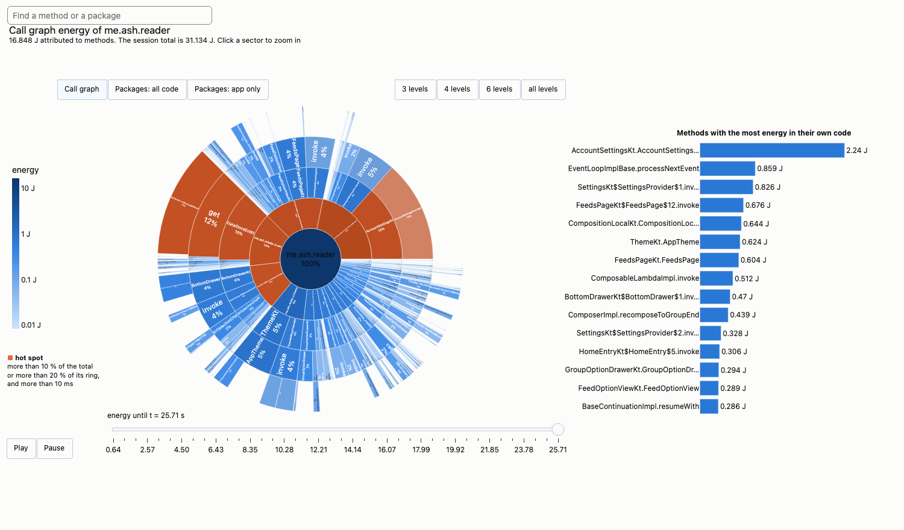

E-MANAFA
========

**Energy Monitor and ANAlyzer For Android.** E-MANAFA measures the energy and the memory that
an Android device consumes while an app runs. It needs only an ``adb`` connection to the
device: no root access and no external power meter.

It gives:

- the energy of a session, for each hardware component (CPU, display, radios, and others);
- the system memory during the session;
- the energy of each method of the app;
- a sunburst diagram of the energy in the call graph, with hot spots.

Where to start
--------------

.. list-table::
   :widths: 35 65

   * - :doc:`getting_started`
     - Install the tool and do a first measurement in five minutes.
   * - :doc:`how_it_works`
     - The workflow, the two sources of energy data, and how a method gets its energy.
   * - :doc:`usage`
     - One recipe for each scenario: energy, memory, the two together, legacy devices, and more.
   * - :doc:`method_energy`
     - Record the methods of an app and get the energy of each one.
   * - :doc:`sunburst`
     - Make and read the sunburst diagram.
   * - :doc:`output`
     - The files that a session writes, and their fields.
   * - :doc:`library`
     - Use E-MANAFA from Python code.
   * - :doc:`accuracy`
     - What the numbers mean, measured errors, and limits.
   * - :doc:`troubleshooting`
     - Messages and problems, with their cause and solution.
   * - :doc:`modules`
     - Reference of the Python modules.

.. toctree::
   :hidden:
   :maxdepth: 2
   :caption: User guide

   getting_started
   how_it_works
   usage
   method_energy
   sunburst
   ondevice
   mcp
   output

.. toctree::
   :hidden:
   :maxdepth: 2
   :caption: Reference

   cli
   library
   accuracy
   troubleshooting
   development
   modules

Publication
-----------

Rui Rua and João Saraiva. *E-MANAFA: Energy Monitoring and ANAlysis Tool For Android.*
ASE 2022. https://doi.org/10.1145/3551349.3561342
