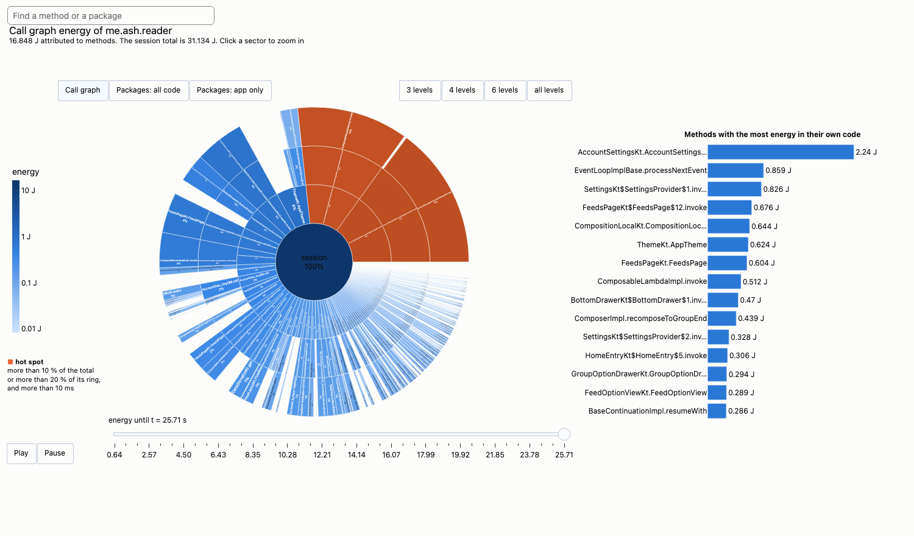
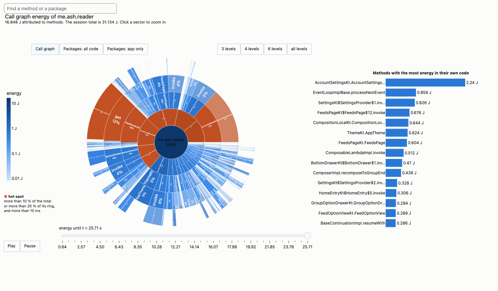

Sunburst diagram
================

The sunburst shows where the app consumes energy in its call graph.

.. code-block:: console

   $ pip install plotly
   $ emanafa -a com.example.app -s 30 --sunburst app.html

Open ``app.html`` in a browser. The file contains all that it needs.

The diagram needs the power rails. With the legacy model, E-MANAFA writes no diagram.

The three views
---------------

Select a view with the buttons above the diagram.

Call graph
~~~~~~~~~~

The graph starts at the methods of the app and contains all that they call. Each ring is one
call level. A sector is one **call path**: a method with its callers. All the calls of a
method that have the same callers are one sector. The size and the colour of a sector show
its energy, with its callees.

Packages: all code
~~~~~~~~~~~~~~~~~~

Three rings: the inner ring is the package, the next ring is the class, and the outer ring is
the method. The view contains the app, the libraries and the Android framework. A sector
shows the energy that the methods consumed in their own code.

Packages: app only
~~~~~~~~~~~~~~~~~~

The first three rings are the packages, the classes and the methods **of the app only**.
Below each method are the calls that it makes to other code (libraries and framework). A
method sector contains the energy of its own code and of the code that it calls.

A call to a different method of the app is not below the caller. That method has its own
sector. Thus no energy is counted two times, and the sectors add up to the total.

The app is the package that you give with ``-a``. Use ``--package`` to select a different
package prefix.

Hot spots
---------

A sector is orange, and not blue, when both of these are true:

1. It has more than 10 % of the energy of the diagram, **or** more than 20 % of the energy of
   its ring.
2. It ran for more than 10 ms.

In the two colours, a darker sector has more energy (logarithmic scale). The hot spots are
decided with the values of the full session.

Change the limits with ``--hot-total``, ``--hot-ring`` and ``--hot-min-ms``.

Controls
--------

.. list-table::
   :header-rows: 1
   :widths: 28 72

   * - Control
     - Function
   * - Click a sector
     - Zoom in. Click the centre to go back.
   * - Pointer on a sector
     - Shows the full name, the energy, the energy in its own code, the number of calls, the
       mean energy of one call, and the execution time.
   * - Level buttons
     - Select how many rings are shown.
   * - Search box
     - Finds a method or a package and gives the sectors a thick outline.
   * - Bar chart
     - The methods with the most energy in their own code. Click a bar to find the method
       in the diagram.
   * - Slider and Play
     - Show how the energy grows during the session.

What the values are
-------------------

- A value is the **total of all the calls** of the method or of the call path. It is not a
  mean. The hover text gives the mean energy of one call.
- The energy comes from the CPU rails (see :doc:`how_it_works`).
- Methods that only wait (for example ``Object.wait`` or an idle ``Looper``) get no energy.
- When methods of different threads run at the same time, the energy is divided between them.
- Call paths with less than 0.05 % of the energy are not drawn. Their energy stays in their
  caller.

Make the diagram from a result file
-----------------------------------

You can make the diagram again, with other options, from the JSON file of a session. The
method trace (``*_calls.csv``) must be in its initial location.

.. code-block:: console

   $ python3 -m manafa.sunburst results.json -o app.html

.. list-table::
   :header-rows: 1
   :widths: 34 66

   * - Option
     - Function
   * - ``-o, --out <file>``
     - Name of the HTML file.
   * - ``--focus <prefixes>``
     - Start the call graph at these package prefixes (separated by commas). The default is
       the app package. ``all`` keeps the full process.
   * - ``--package <prefix>``
     - Package prefix of the "app only" view. The default is the app package.
   * - ``--max-depth <n>``
     - Number of call levels below the start points. Default 10.
   * - ``--hot-total <pct>``
     - Limit of a hot spot: percentage of the energy of the diagram. Default 10.
   * - ``--hot-ring <pct>``
     - Limit of a hot spot: percentage of the energy of its ring. Default 20.
   * - ``--hot-min-ms <ms>``
     - A hot spot must also run for more than this time. Default 10.
   * - ``--frames <n>``
     - Number of steps of the time slider. Default 40.
   * - ``--include-blocked``
     - Also give energy to methods that only wait.

Examples:

.. code-block:: console

   $ python3 -m manafa.sunburst results.json --focus com.example.ui,androidx
   $ python3 -m manafa.sunburst results.json --focus all --max-depth 20
   $ python3 -m manafa.sunburst results.json --hot-total 5 --hot-ring 30 --hot-min-ms 50
